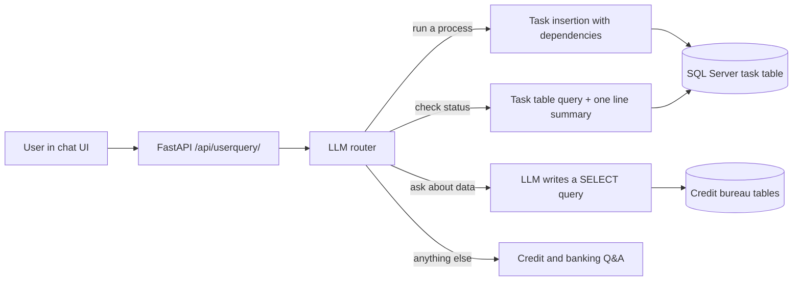

# credit-agent

A chat assistant for credit operations. You type what you need in plain English, for example "run underwriting for ABC123" or "show the bureau demog details for ABC123", and it works out the intent, queues the right steps for that application, and reports back on their status.

It is the chat and routing layer. The underwriting and bureau steps themselves (downloading documents, extracting data, CRM checks, building the credit assessment summary) are picked up from a task table by the automation that already runs them. This service decides what to run and records it.

## How it works



1. The router prompt (`gpt-4o-mini`, temperature 0) reads the message and returns JSON: the intent, the Webtop IDs it found, and which stages to run.
2. For a "run" intent, `task_insertion` looks up the requested stage in the task master table, walks its dependencies, and inserts the stage plus any prerequisite stages that are not already queued. The request is also logged with status `InProgress`.
3. For a data question, a second prompt writes a single `SELECT` over the bureau tables, the query is executed, and the rows come back as a Markdown table.
4. For a status question, the task table is queried and summarised in one sentence.
5. Everything else goes to a general credit, NBFC and banking assistant that declines off-topic questions.

Conversation history is kept in memory (`data_igestion/ingestion_pipeline.py`) and passed to the router so follow-ups like "now do the same for 8043g803jg20" work.

## What you can ask for

| Intent | What it does | Stages |
| --- | --- | --- |
| `run_credit_underwriting_bot` | Full credit underwriting, or any single stage | document_download, data_extraction, crm_scraping, offer_check, external_checks, internal_checks, data_validation, cas_preparation |
| `run_bureau_analysis_bot` | Summarises a customer's bureau report | document_download, data_extraction, data_validation, report_creation |
| `run_bureau_comparison_bot` | Compares an old and a new bureau report | document_download, data_extraction, data_validation, report_creation |
| `run_bureau_demog_bot` | Checks bureau demographics against internal records | document_download, data_extraction, data_validation, report_creation |
| `run_bureau_deviation_bot` | Flags exceptions and risk indicators in a bureau report | document_download, data_extraction, data_validation, report_creation |
| `knowledge_base` | Answers questions about stored bureau data for a Webtop ID | n/a |
| `checkstatus` | Reports which tasks are in progress or done | n/a |
| `general` | Credit, NBFC and banking questions | n/a |

If you ask about a Webtop ID without saying "run" or "execute", it is treated as a data question and nothing is queued.

## API

| Method | Path | Body | Purpose |
| --- | --- | --- | --- |
| GET | `/` | none | Health check |
| POST | `/api/userquery/` | `{"unique_id": "<work id>", "user_query": "<message>"}` | Send a chat message |
| POST | `/api/reset/` | none | Clear the conversation history |

Run intents reply with `{"mesaage": "..."}` (spelled that way in the current code). Every other intent replies with `{"message": "..."}`.

## Project layout

```
backend/
  main.py                      FastAPI app and intent handling
  prompt_library/prompt.py     router, SQL-writing and general Q&A prompts
  toolkit/                     task insertion with dependency lookup, chat helper
  data_models/                 async SQLAlchemy engine and the prompt log model
  data_igestion/               in-memory conversation state
  sql_statement/               table schema text given to the SQL-writing prompt
  notebook/                    early experiments
Frontend/
  src/pages/ChatInterface.jsx  chat screen
  src/pages/Dashboard.jsx      task status dashboard (sample data for now)
```

## Running it locally

Needs Python 3.12, Node 20+, the Microsoft ODBC Driver 17 for SQL Server, and an OpenAI API key.

Backend:

```bash
cd backend
python -m venv .venv && source .venv/bin/activate
pip install -r requirements.txt
```

Create `backend/.env`:

```
OPENAI_API_KEY=
DB_DRIVER=ODBC Driver 17 for SQL Server
DB_SERVER=
DB_NAME=
DB_USER=
DB_PASS=
```

```bash
uvicorn main:app --reload --host 127.0.0.1 --port 8000
```

Frontend:

```bash
cd Frontend
npm install
echo "VITE_BACKEND_URL=http://127.0.0.1:8000" > .env
npm run dev
```

## Known limitations

- The SQL the model writes for data questions is executed as is. Point it at a read-only database login.
- Conversation state is one in-process global, so it is shared by everyone using the same server. Fine for a demo, not for several users at once.
- Only the last stage in a request is passed to task insertion, which then adds its prerequisites. Asking for a custom set of non-contiguous stages is not supported.
- The dashboard page shows placeholder tasks, not live data.
